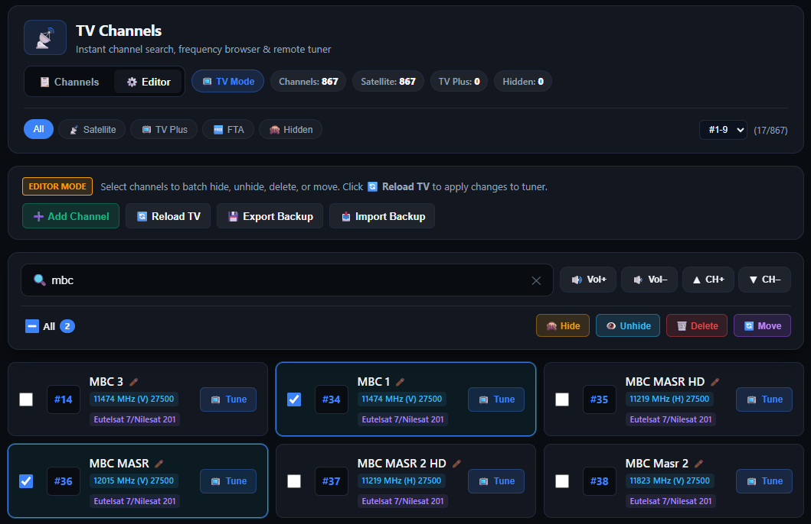

# TV Channels

Browse, switch, search, and manage satellite (DVB-S) and Samsung TV Plus (IPTV) channels with instant tuning, in-place renaming, slot-conserving move/sort, optional DVB category gap closure, and validated backup export/import.

  

## What it does

Adds a unified **Channels** tab to the Vetro dashboard:
- **Instant Direct Tuning:** Switches channels instantly (<100ms) via direct service ID (`tune_channel <srvId>`), with high-speed D-Bus key injection fallback. Never relies on slow single-digit entry delays.
- **In-Place Channel Renaming:** Click any channel name in Editor view to rename it directly by unique `srvId` (`elim = 0`, 1–60 printable characters). Automatically encodes UTF-16 hex and updates `SRV.srvName` and `modifiedByUser = 1`.
- **Channel Move & Reordering:** Move single or multiple channels (selected strictly by `srvId`) to a new target slot within the same source and DVB service category (TV, Radio, or Data), conserving slots without overwriting existing channels.
- **Optional Gap Closure on Deletion:** Deleting channels marks `elim = 1` without renumbering by default. On DVB-S, an unchecked-by-default option lets you compact remaining visible channels within the edited service category (`tv` vs `radio` vs `data`) while keeping hidden channels at their slots; Samsung TV Plus (`ipsrv`) channel numbers are never compacted. Delete and hide/unhide on both lists are applied in one SQLite `ATTACH` transaction with `-bail` (a power cut during `COMMIT` can still leave one list changed).
- **Live Daemon Reload Behavior:** Edits write to SQLite on disk while Samsung's `tvs-daemon` caches the active channel table in memory. Click **🔄 Reload TV** after editing so the TV tuner picks up changes; until reloaded, remote-control edits or daemon-initiated saves can overwrite unapplied SQLite changes (an amber banner stays visible whenever edits are pending reload).
- **Vetro TV Tuner (0.7.0+) Integration:** When Vetro's built-in **Vetro TV Tuner** (`vetro-tuner.service`) is enabled, **Reload TV**, **Import**, and **Restore Previous** automatically restart `vetro-tuner.service` (`--no-block`, with `quit` pipe fallback) so it drops its cached channel list and reconnects cleanly. When Vetro TV Tuner is currently on screen (`/tmp/vetro-tuner.ctl.shown`), `CH+`, `CH-`, `Exit`, and unambiguous live-TV tuning route through `/tmp/vetro-tuner.ctl` (`key 88` / `key 87` / `key 174` / `tune <N>`) so Vetro's banner and channel cursor stay in sync. When Vetro TV Tuner is off or hidden, everything falls back unchanged to `input_keyevent` and `launch_app tune_channel`.
- **Non-Disruptive Reload, Import & Restore:** Reloading, importing, or restoring backups leaves your current input source undisturbed (it never forces a switch away from HDMI or streaming apps back to Broadcast TV). Use the explicit **📺 TV Mode** button whenever you want to switch to Live Broadcast TV.
- **Instant Search, Filter & Multi-Mode Sorting:** Search across all channels by number, name, frequency, or transponder. Sort channels by number (#1-9 / #9-1) or alphabetically (A-Z / Z-A).
- **Source & Visibility Filters:** Filter between All, 📡 Satellite, 📺 TV Plus, 🆓 FTA (Free to Air), and 🙈 Hidden channels.
- **Batch Selection & Sticky Toolbar:** Sticky controls panel keeps search and batch actions (`All`, `🙈 Hide`, `👁️ Unhide`, `🗑️ Delete`, `🔄 Move`, `↩️ Restore Previous`) accessible while scrolling, keyed uniquely by source and `srvId` (`type:srvId`).
- **Validated Export, Import & Two-Slot Rollback:**
  - **Export Backup** runs under the database lock and packages existing TV channel databases (`dvbs`, `sat`, `ipsrv`, `dvbt`, `dvbc`) into a Samsung `Channel_list_<Version>.zip` archive, including the TV's own `metadata.xml` only when present on disk (never synthesizing hardcoded country codes).
  - **Import Backup** enforces a 15 MB upload limit, checks uncompressed zip bounds (32 MB / 50 entries) and paths via `/usr/bin/unzip -l`, extracts only allowlisted non-symlink files, validates SQLite `PRAGMA integrity_check`, table/column schemas, and `PRAGMA user_version` while `tvs_deamon.service` keeps running, requires explicit confirmation if region `metadata.xml` or filename model differs (without overwriting the TV's `metadata.xml`), expires unconfirmed staged imports automatically after 5 minutes while re-verifying per-file SHA-256 hashes before apply, and then swaps files atomically under `flock` + stopped daemon with an `EXIT`-trap restart guarantee and in-script rollback. Import and restore preserve each existing database file's original mode and `uid:gid` via `stat` (on UA50AU7000, Samsung's `tvs-daemon` natively creates `/mnt/systemrw/tvs-chms/data/{dvbs,sat}` as `0644` `root:root` with Smack label `System::Privileged`, while prior USB imports may leave `0777`; newly introduced files default to `0644` `0:0`).
  - **Two-Slot Restore Previous** maintains both a **Pre-Edit Snapshot** (`backup/pre-edit/` captured via online SQLite `.backup` before `delete` and `move`) and a **Pre-Import Snapshot** (`backup/pre-import/` captured under stopped daemon before ZIP import) so normal edits never erase your pre-import rollback point.
- **TV Remote Controls & Sticky Reload:** Sticky header controls for Volume (`Vol+`, `Vol-` with click-and-hold auto-repeat) and Channel switching (`CH+`, `CH-`).

## Permissions

`exec` — to query and update channel records in `/mnt/systemrw/tvs-chms/data/`, tune channels via `/usr/bin/launch_app` and D-Bus, send allow-listed remote keys via `/usr/bin/input_keyevent`, switch input source on explicit **📺 TV Mode**, and manage Samsung's channel daemon (`tvs_deamon.service`, falling back to `tvs_daemon.service` if present).

## Commands it runs

| Command | Why |
| --- | --- |
| `/usr/bin/launch_app org.tizen.tv-viewer tune_channel <srvId>` | Instant direct channel switching via native TV service ID without digit delay |
| `/usr/bin/launch_app org.tizen.tv-viewer change_source 0 sourceType 0 sourceName TV mbrIndex -2 __K_EX_LAUNCH_REQUESTOR user` | Switches input to Live Broadcast TV only when clicking **📺 TV Mode** |
| `dbus-send --system --type=method_call --dest=org.enlightenment.wm /org/enlightenment/wm org.enlightenment.wm.Test.EventKey uint32:<0\|1> string:<key>` | Fallback key injection for numeric channel tuning or exiting TV menus |
| `/usr/bin/input_keyevent <keysym>` | Sends remote key events strictly from the allow-list: `XF86AudioRaiseVolume`, `XF86AudioLowerVolume`, `XF86AudioMute`, `XF86RaiseChannel`, `XF86LowerChannel`, `XF86Exit` |
| `sqlite3 -bail ...` | Reads channel tables (optional missing DBs skipped), creates online `.backup` pre-edit snapshots, runs inline quoted here-document `-bail` SQL scripts for edits without `/tmp/*.sql` temp files, and checkpoints WAL logs |
| `sqlite3 [-readonly] <dbPath> "PRAGMA integrity_check;" / "PRAGMA user_version;" / "SELECT name FROM sqlite_master ..." / "PRAGMA table_info(...);"` | Verifies SQLite integrity, schema tables, columns, and `user_version` during import and backup restore |
| `echo <base64> \| base64 -d \| sh` | Runs serialized SQLite, export, reload, import validation/swap, restore, TV source, and pre-edit backup scripts cleanly through Vetro's root agent |
| `/usr/bin/flock -n 9` | Serializes stopped-daemon swap, restore, and reload operations on `/tmp/vetro_channels_db.lock` |
| `systemctl cat` / `stop` / `start` / `restart` `tvs_deamon.service` (fallback `tvs_daemon.service`, or `pkill -9 tvs-daemon` on reload only if unit absent) | Resolves the service unit, cleanly stops it during DB replacement, guarantees restart via shell `EXIT` trap, and restarts it on **Reload TV** |
| `systemctl is-active` / `restart --no-block vetro-tuner.service` | Refreshes Vetro TV Tuner's cached channel list after `tvs-daemon` reloads (complete no-op when Vetro TV Tuner is not running) |
| Non-blocking FIFO write (`exec 3<>/tmp/vetro-tuner.ctl`, `echo` / `printf`) | Sends `key 88` (`CH+`), `key 87` (`CH-`), `key 174` (`Exit`), `tune <N>`, `hide`/`show` (cursor resync after direct `srvId` tune), `resume`, or `quit` when Vetro TV Tuner is active/on screen |
| `stat` / `sha256sum` / `cp` / `cp -p` / `mv` / `chmod` / `chown` / `wc` | Captures and preserves original TV DB mode/owner (`0644` `0:0` default), verifies staged import SHA-256 integrity inside a `0700` staging directory, checks symlinks, manages atomic backup rotation into `<shard-dir>/backup/`, and checks extracted file sizes |
| `rm -f .../*-wal .../*-shm` / `rm -f` / `rm -rf` / `mkdir -p` / `mkdir -m 0700` | Removes stale WAL/SHM files while the daemon is stopped, creates the private `0700` import staging dir, and cleans staging/temp files |
| `cat` / `grep -i "^Version="` / `head` / `cut` / `tr` | Reads TV `metadata.xml` and `/etc/prd_info.ini` version/model metadata |
| `/usr/bin/zip -j /tmp/ch_exp_*.zip ...` | Packages existing TV channel databases (and existing `metadata.xml` if present) under lock |
| `/usr/bin/unzip -t` / `/usr/bin/unzip -l` / `/usr/bin/unzip -o -q` | Validates zip integrity, enforces size/entry/path limits, and extracts only allowlisted non-symlink files |
| `sleep 1` / `sleep 0.5` / `sleep 0.05` | Pauses briefly after daemon restart or D-Bus key events |

## Network

None. All queries and commands execute locally on the TV.

## Data it keeps

- **Persistent backups (`<shard-dir>/backup/`):**
  - `pre-import/`: databases (`dvbs`, `sat`, `ipsrv`, `dvbt`, `dvbc`) and `backup-meta.json` captured while `tvs_deamon.service` is stopped right before applying an imported ZIP archive.
  - `pre-edit/`: online SQLite `.backup` snapshot and `backup-meta.json` captured before every `delete` or `move` edit, leaving `pre-import/` intact.
  - Note: Shard updates replace files in the plugin directory other than `config.json`, and uninstalling the Shard removes it (use **Export Backup** for permanent off-TV copies).
- **Temporary files in `/tmp/`:** `/tmp/ch_exp_*.zip`, `/tmp/ch_up_*.zip`, `/tmp/ch_imp_*`, `/tmp/ch_stage_*`, `/tmp/ch_rb_*`, and `/tmp/vetro_channels_db.lock`. Cleaned up on normal completion, stream abort/error, `stop()`, staged-import 5-minute expiry, and via shell `EXIT` traps; an unexpected `SIGKILL` or power loss mid-operation may leave a temp file in `/tmp` until the TV reboots.

> [!WARNING]
> Importing or restoring a channel backup replaces the TV's native channel databases in `/mnt/systemrw/tvs-chms/data/` while `tvs_deamon.service` is stopped. Always verify backups before confirming region or model mismatch warnings.

## Tested Environment

- **Model:** Samsung Smart TV UA50AU7000 (Tizen 6.0)
- **Vetro Version:** Vetro 0.5.0 (Node v12.4.0) & Vetro 0.7.0 (with Vetro TV Tuner enabled)

*Note:* Tested specifically on Samsung Smart TV UA50AU7000 running Tizen 6.0 with Vetro 0.5.0 and Vetro 0.7.0 (Vetro TV Tuner enabled); behavior on other TV models and firmware versions is untested.
