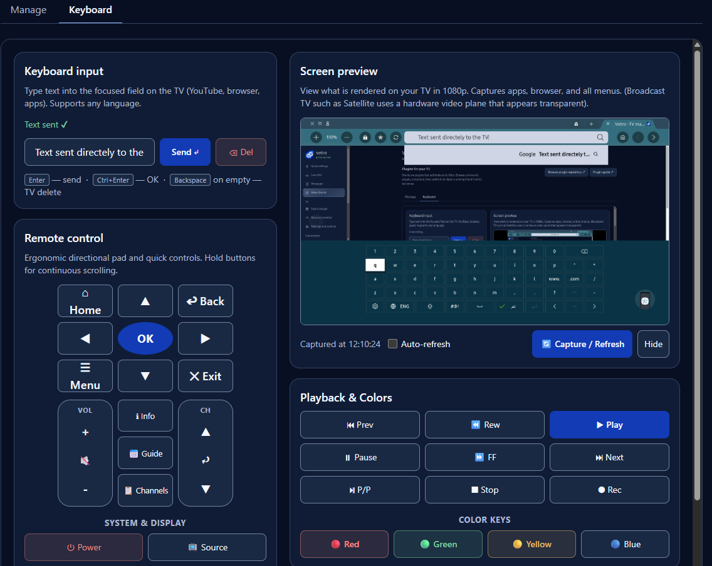

# Keyboard & Remote

Type text in any language from your browser into focused input fields on your Samsung Smart TV, view a live 1080p screen preview, and control your TV with full navigation, volume, channel, media playback, and interactive color keys.

  

## What it does

Adds a unified **Keyboard** tab to the Vetro dashboard:
- **Text Input & Direct PC Keyboard Typing:**
  - **Instant Physical Keyboard Typing:** On PC, any letter (lowercase or uppercase with <kbd>Shift</kbd>), digit, space, symbol, or pasted text (<kbd>Ctrl+V</kbd>) typed on your keyboard is sent directly to the TV the moment you press the key—without having to focus the input box or press Enter/Send. Non-ASCII languages (such as Arabic) automatically accumulate characters into words and phrases via direct text buffering, and Backspace seamlessly deletes the last character.
  - **Direct Remote & Editing Shortcuts:** Press <kbd>Enter</kbd> to send typed text (in input box) or submit focused field / URL bar (outside input box), <kbd>Ctrl+Enter</kbd> to send an `OK` (`Return`) click, <kbd>Ctrl+S</kbd> to open Search, <kbd>Ctrl+A</kbd> to Select All, <kbd>Ctrl+Z</kbd> to Undo, <kbd>Backspace</kbd> to delete on TV, <kbd>Escape</kbd> to go Back, <kbd>Home</kbd> to open TV Home, and <kbd>Arrow keys</kbd> to navigate.
  - **Dynamic Device Pairing Name:** Automatically identifies pairing requests on your TV screen by device and browser (e.g. `Vetro (Windows Chrome)`, `Vetro (Android Chrome)`) so you always know which device is connecting.
  - **Mobile On-Screen Keyboard Support:** In fullscreen theater mode (`#screen`), mobile devices keep the input box docked at the bottom so you can tap to summon the mobile virtual keyboard, while PC hides it to maximize 100% vertical screen space (with a `⌨ Input` toolbar button to toggle on/off at will).
- **Interactive Live Screen Preview:** Expandable full-width 1080p TV display preview with direct pointer & gesture control:
  - **Pointer Mode (`🖱 Pointer`):** Tap to click, double-tap to double-click, press & hold, press & drag (for sliders, scrollbars, and text selection), right-click, `Move only` hover mode, and scroll wheel support across the entire `1920×1080` screen (browser chrome, tabs, URL bar, web pages, and pointer-enabled apps).
  - **D-Pad Mode (`🕹 D-Pad`):** Swipe or tap directional zones directly on the preview to navigate and select items in D-Pad-only apps that ignore mouse input (such as YouTube or Netflix).
- **Navigation & D-Pad:** Full directional control (`Up`, `Down`, `Left`, `Right`, `OK`), `Home`, `Back`, `Menu`, `Info`, `Exit`.
- **Volume & Channels:** `Volume +`, `Volume −`, `Mute`, `Channel +`, `Channel −`, `Previous Channel`, `Channel List`, `Guide`.
- **Smooth Continuous Hold:** Press and hold arrow keys, volume, or channel buttons on your physical keyboard or screen to smoothly and continuously scroll without lag or stutter (native press/release with a 6 s auto-release safety timeout).
- **System & Display:** `Power`, `TV / Source`, `Quick Menu`, `Search`, `Subtitles`, `MultiView`, `Aspect Ratio`, `Ambient mode`.
- **Media Playback:** `Play`, `Pause`, `Play/Pause`, `Stop`, `Fast Forward`, `Rewind`, `Next`, `Previous`, `Record`.
- **Interactive Color Keys:** Samsung remote `Red (A)`, `Green (B)`, `Yellow (C)`, `Blue (D)` buttons.
- **Numeric Keypad:** Numbers `0`–`9` and `−` for direct channel entry.

## Text Input & App Compatibility

Samsung Smart TVs handle text entry in two different ways depending on the app:
- **Native OS Input Fields (Direct Typing Supported):** Apps that use standard input fields invoke the TV's native system keyboard (such as the Samsung Internet Browser address bar, system settings, Wi-Fi password dialogs, account login screens, and web apps with native `<input>` elements). In these fields, text typed from the browser is injected directly into the active field in any language.
- **Custom In-App Keyboards (Use D-Pad Navigation):** Many TV streaming apps (such as YouTube, Netflix, or Prime Video) build their own custom on-screen letter grid instead of using the OS virtual keyboard. Because spatial focus in these apps is placed on individual letter tiles rather than a text cursor, direct text injection is not routed to their search bar. Use the remote **D-Pad** (`Up`, `Down`, `Left`, `Right`, `OK`) to navigate and select letters on their custom grid.

## Permissions

`exec` — to run `/usr/bin/input_keyevent` for remote control keys and local text input, `/usr/bin/enlightenment_info` for mouse actions, and `dbus-send` (Enlightenment D-Bus) to capture frame buffer screenshots.

## Commands it runs

| Command | Why |
| --- | --- |
| `/usr/bin/input_keyevent <keysym> [down\|up]` | Injects remote-control key taps and native press/release holds (with a 6 s auto-release safety cap) |
| `sh -c "/usr/bin/input_keyevent Control_L\|Shift_L down; /usr/bin/input_keyevent <keysym>; /usr/bin/input_keyevent Control_L\|Shift_L up"` | Sends modified key combinations (`Ctrl+A`, `Ctrl+Z`, shifted/uppercase keys) |
| `sh -c '/usr/bin/input_keyevent ...; sleep 0.04; ...'` | Chains mapped ASCII key events (wrapping uppercase and shifted symbols in `Shift_L down/up`) with `sleep 0.04` between characters for local text typing |
| `sh -c '/usr/bin/enlightenment_info -init_device --node=/dev/input/event<N>; /usr/bin/enlightenment_info -mousegen ...; /usr/bin/enlightenment_info -deinit_device'` | Provides native TV scroll wheel events and fallback cursor movement, clicks (`usleep 60000` for double-clicks), and drag/hold (with 6 s inactivity / 30 s max auto-release timeout) when WebSocket is unavailable |
| `dbus-send --system --print-reply --dest=org.enlightenment.wm /org/enlightenment/wm org.enlightenment.wm.info.dump_screen string:'/tmp/shot_<id>.png'` | Captures a full-resolution 1080p frame buffer snapshot from the Enlightenment window manager into a unique temporary file, deleted immediately after reading |
| `rm -f '/tmp/shot_<id>.png'` | Fallback cleanup as root when the Vetro service runs as a non-root user and cannot unlink a root-owned screenshot file in sticky `/tmp` |

## Network

| Host | Port | Protocol | Why |
| --- | --- | --- | --- |
| TV IP | `8002` | WSS (TLS, encrypted) | Samsung Remote WebSocket API (2019+ TVs) — injects full Unicode text in any language directly from the browser, and provides native hardware key press/release. Plaintext port 8001 is intentionally not used to prevent sending keystrokes or tokens unencrypted over the LAN. |

## Data it keeps

`config.json` stores `{"token":"..."}` (file mode `600`) — the Samsung Remote API pairing token. `status()` and `GET api/status` only expose `paired: true/false` so the raw token does not appear in the Vetro Shard detail view. Because Vetro renders Shard pages inside a sandboxed iframe without `localStorage`, the Shard page reads the saved token on load via `GET api/token` (`Cache-Control: no-store`) so it can reconnect to port `8002` without re-prompting "Allow" on every visit.

## Security & Privacy Notice

- **Pairing Token (`GET api/token`):** Returns the saved Samsung Remote API token from `config.json`. While Vetro pairing is **off**, anyone who can reach Vetro's HTTP port on the LAN can call this route and keep the Samsung token; with Vetro pairing **on**, only paired devices with an active Shard session can call it. Note that turning Vetro pairing on later or removing this Shard only protects or deletes `config.json`—it does **not** revoke the grant already stored on the TV, so a copied token continues to work on port `8002` until you revoke the device in the TV's settings (**Settings → General → External Device Manager → Device Connection Manager → Device List**, or **Settings → Connection → External Device Manager → Device Connection Manager → Device List** on newer Tizen versions).
- **Frame Buffer Capture (`GET api/screenshot`):** Captures and returns the TV's full `1920×1080` frame buffer. While Vetro pairing is **off**, anyone who can reach Vetro's HTTP port can call this route; with Vetro pairing **on**, only paired devices with an active Shard session can call it. The captured image includes running applications, browser contents, and any visible on-screen text or typed passwords. Temporary image files (`/tmp/shot_<id>.png`) are written with per-request unique names and unlinked from the TV disk immediately after reading.
- **Local Typing Execution (`POST api/type`):** Typing via the local TV shell command is capped at 200 characters and supports partial US ASCII (letters, numbers, standard symbols). Any unsupported characters are omitted with a warning. Full Unicode text (Arabic, Hebrew, Cyrillic, CJK, emoji, etc.) is handled via the encrypted WebSocket connection on port 8002.

## Screen Preview & Display Layers

The Screen Preview feature captures the TV's native graphics and OSD compositor plane (Enlightenment):
- **What is captured:** Running apps (YouTube UI, streaming app homepages, browser pages), on-screen keyboards, search fields, channel banners, volume and input overlays, system dialogs, and settings menus.
- **Hardware video overlay plane:** Broadcast TV (Satellite DVB-S2, Cable, Antenna) and protected HDMI inputs are decoded directly by the TV SoC's hardware video processing unit (VPU) on an isolated hardware overlay plane with broadcast DRM. The window manager punches a transparent hole (`alpha = 0`) in the graphics plane for this video to show through on the physical display panel, so screenshots capture this video viewport as transparent.

## Keyboard shortcuts (when focused on page)

| Key | Action |
| --- | --- |
| Printable characters (letters, numbers, symbols, spaces) | Instant direct typing to TV |
| `Enter` (in input box) | Send typed text to TV and commit |
| `Enter` (outside input box) | Submit focused field / URL bar (Android keyboard Enter) |
| `Ctrl+Enter` | Send OK / confirm to TV |
| `Ctrl+S` | Open TV Search |
| `Ctrl+A` | Select all text in focused TV input field |
| `Ctrl+V` (or paste) | Paste text directly to TV |
| `Ctrl+Z` | Undo in focused TV input field |
| `Backspace` (in empty box) | Send Backspace to TV |
| `Escape` | Send Back to TV |
| `Home` | Open TV Home / Smart Hub |
| Arrow keys (held or pressed) | Move TV cursor / D-Pad |

## Tested Environment

- **Model:** Samsung Smart TV UA50AU7000 (Tizen 6.0)
- **Vetro Version:** Vetro 0.5.0 (Node v12.4.0)
